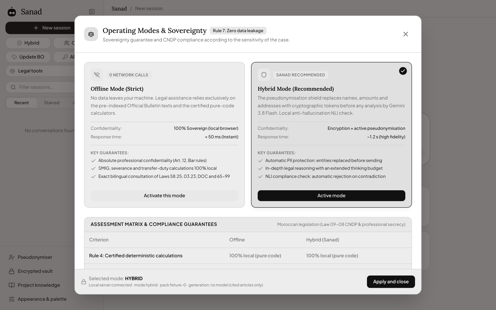
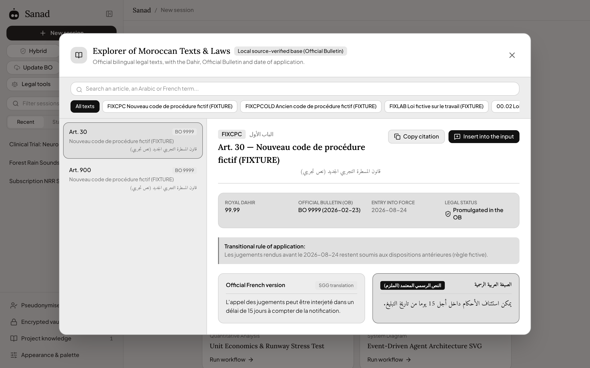
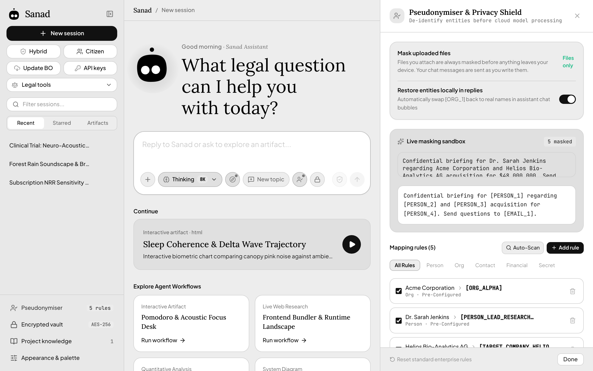
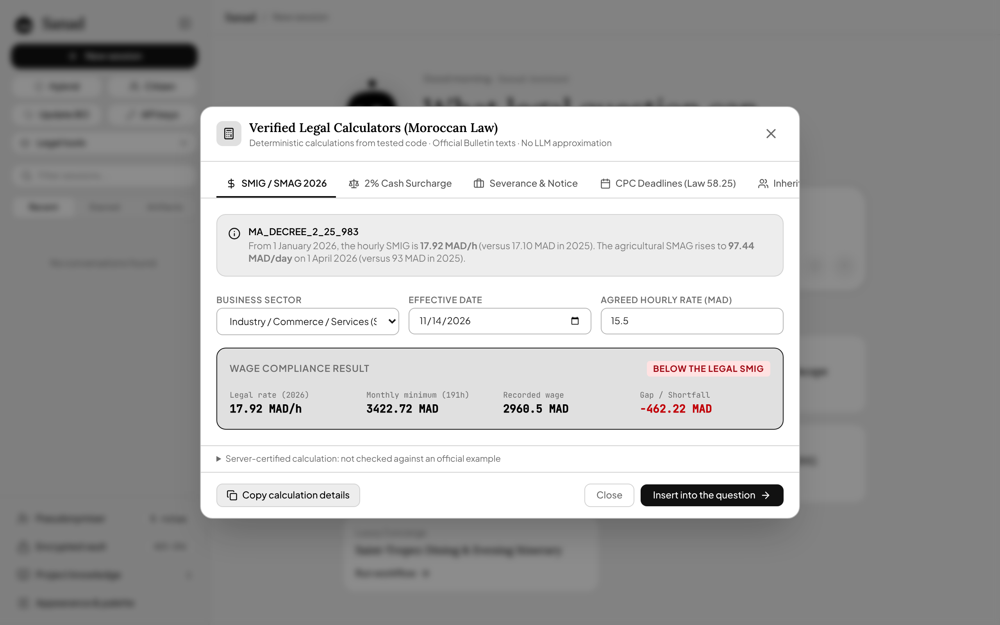

<div align="center">


# Sanad · سند

**A Moroccan law assistant that runs on your own computer and answers only from the official texts.**

Arabic · French · English · Darija

[Download for Windows](#install-on-windows) · [Law pack on Hugging Face](https://huggingface.co/datasets/Xdnh00p/sanad-lawpack) · [Run from source](#run-from-source) · [How it works](#how-it-works)


</div>

Sanad searches Moroccan laws, codes and Official Bulletin issues, quotes the articles it relies on, and checks every
claim of the answer against those articles before showing it. Names, amounts and addresses are replaced by placeholders
on the device before anything is sent to a language model, and the app can also work fully offline.

> Sanad is a reading aid. It is not legal advice.

## What it does

| | |
|---|---|
| **Answers with sources** | Date-aware hybrid search (dense + keyword + reranker) over the law pack. Each answer cites articles, and unsupported claims are removed or the answer falls back to quoted passages. |
| **Privacy first** | The backend listens on `127.0.0.1` only. Personal data is pseudonymised locally; you see exactly what would be sent before it leaves. |
| **Two operating modes** | Offline (no network calls) and Hybrid (pseudonymised text to the model you choose). |
| **Legal tools** | Calculators (SMIG/SMAG, severance, deadlines, inheritance…), citizen situation guides, statute browser with the version in force on a given date, concordance tables, contract check. |
| **Signed law pack** | The laws and their embeddings ship as one signed file. A pack that is not signed by the publisher is refused. |
| **Stays current** | "Update BO" finds new Official Bulletin issues and adds them to your local pack. |

## Screenshots

The screenshots below were taken with the small synthetic test pack (texts marked *FIXTURE*), not with the real law pack.

| Operating modes | Statute browser |
|---|---|
|  |  |

| Citizen situation guides | Pseudonymiser |
|---|---|
|  |  |

<div align="center">

</div>

## Install on Windows

Download one of the two installers from the [Releases page](https://github.com/Ayyoubsghuri/Sanad/releases). They install the same thing; pick either.

| File | Type |
|---|---|
| `SanadSetup-<version>.exe` | Setup wizard (English, French, Arabic) |
| `Sanad-<version>.msi` | Windows Installer package, for example for `msiexec /i Sanad-<version>.msi` |

Both install for the current user only, without administrator rights, into `%LOCALAPPDATA%\Programs\Sanad`, and add a
**Sanad** shortcut with the Sanad logo to the Start menu and the desktop.

**The first start downloads everything else** (about 7 GB, so keep the internet connection and the window open):

1. A private Python 3.12 and the backend's packages, into `%LOCALAPPDATA%\Sanad`.
2. The signed law pack (`current.db`, about 2.3 GB) from
   [`Xdnh00p/sanad-lawpack`](https://huggingface.co/datasets/Xdnh00p/sanad-lawpack). Its SHA-256 and the publisher's
   signature are checked before it is installed into `%USERPROFILE%\.moroccan-legal-rag\lawpack`.
3. The local models, into `%USERPROFILE%\.moroccan-legal-rag\models`: the reranker `BAAI/bge-reranker-v2-m3` and the
   embedding model the law pack was built with (`BAAI/bge-m3`).

A setup window shows the progress of that first start; no console window opens. If the download is interrupted,
start Sanad again: it continues where it stopped. **Sanad - repair setup** in the Start menu runs the setup again.

After the setup, the shortcut starts `Sanad.exe`, which opens Sanad in its own window: no browser, no console and no
Windows title bar. The window buttons (minimise, maximise, close) are in Sanad's own top bar, which also moves the
window; the bottom-right corner resizes it.


To get answers written by a language model, open **API keys** in the app and add a key (Anthropic or any
OpenAI-compatible endpoint). Without one, Sanad shows the cited articles only.

Requirements: Windows 10 or 11 (64-bit) with the WebView2 runtime (part of Windows 11 and of current Windows 10), about 12 GB of free disk space, 8 GB of RAM (16 GB recommended). A GPU is
optional.

### Build the installers yourself

The installers are built on Linux by [`installer/build.sh`](installer/build.sh) (needs `node`, `python3`, `makensis`,
`wixl` and the MinGW cross-compiler), which is also what the [GitHub workflow](.github/workflows/installers.yml) runs:

```bash
sudo apt-get install -y nsis wixl gcc-mingw-w64-x86-64
```

```bash
installer/build.sh
```

The files are written to `installer/out/`. To publish a new version, change the number in
[`installer/VERSION`](installer/VERSION) on `main`: the workflow builds the two files and publishes them as the GitHub
Release `v<version>`. Running the **Windows installers** workflow by hand attaches the files to the run instead.

## Run from source

You need Python 3.11 or newer and Node.js 22.

**1. Backend**

```bash
cd backend
pip install -e ".[local-models]"
python tools/install_pack.py
python -m legalrag.fetch_models --pack-embedder
```

`install_pack.py` downloads the law pack named in [`backend/pack_release.json`](backend/pack_release.json) and prints
the publisher's key. Set it and start the backend:

```bash
export LEGALRAG_LAWPACK_PUBLIC_KEY_HEX=086dbbbf9cc34d77f65c376b480be3ab83ad25e12194efee5445a4241aded15c
legalrag
```

On Windows use `setx LEGALRAG_LAWPACK_PUBLIC_KEY_HEX <key>` and open a new terminal.

**2. Frontend**

```bash
cd frontend
npm ci --legacy-peer-deps
npm run dev
```

Open `http://localhost:3000`. The app pairs with the backend by itself; there is no token to copy.

To serve the built frontend from the backend instead (one process, as the installers do), run `npm run build` and
start the backend with `LEGALRAG_FRONTEND_DIR=../frontend/dist`, then open `http://127.0.0.1:8765`.

**Try it without the real pack**

```bash
cd backend
pip install -e ".[dev]"
legalrag-build fixture --out fixture.db
LEGALRAG_LAWPACK_PATH=fixture.db LEGALRAG_ALLOW_UNSIGNED_PACK=true legalrag
```

## The law pack

The repository holds the engine and the source texts. The searchable data is the **law pack**: a single SQLite file
with the texts, their versions over time and their embeddings, signed with Ed25519.

| | |
|---|---|
| Published at | [huggingface.co/datasets/Xdnh00p/sanad-lawpack](https://huggingface.co/datasets/Xdnh00p/sanad-lawpack) |
| Files | `current.db` and `current.db.sig` |
| Version | `2026.11.08.1455-retire` |
| Size | 2,270,830,592 bytes |
| SHA-256 | `6b8d461f7222dd749e4b52368abe55e5f2fe5fdfde1bcdd5f6ff155377fcf110` |
| Publisher key | `086dbbbf9cc34d77f65c376b480be3ab83ad25e12194efee5445a4241aded15c` |

Source texts in this repository (`backend/data/`): 8 codes (obligations and contracts, family, labour, penal, civil and
criminal procedure, commercial, tax), 160 laws, dahirs and decrees, and 48 local-authority gazettes.
[`backend/docs/LAW_IMPORT.md`](backend/docs/LAW_IMPORT.md) explains how to add a law, and
[`backend/README.md`](backend/README.md) how to build and publish a pack.

## How it works

```
question
   │  pseudonymise on the device, show the send preview
   ▼
understand ──► date-aware hybrid retrieval ──► rerank ──► generate (structured JSON)
                (dense + BM25, law pack)                        │
                                                                ▼
                    answer ◄── restore names locally ◄── verify each claim against the cited articles
                                                         (regenerate once, else verified claims only,
                                                          else quoted passages only)
```

| Folder | Contents |
|---|---|
| [`backend/`](backend/) | FastAPI backend (`legalrag`): retrieval, verification, pseudonymisation, calculators, pack builder, tests |
| [`frontend/`](frontend/) | React + Vite interface |
| [`installer/`](installer/) | Windows installers (`.exe` with NSIS, `.msi` with WiX), the `Sanad.exe` launcher and the first-start setup |
| [`blueprint/`](blueprint/) | The design document in English, French and Arabic |

## Limitations

- The calculators are labelled *unverified* unless they were checked against an official worked example.
- Pseudonymisation is based on patterns, dictionaries and an optional Arabic NER model. Review the send preview for
  unusual names.
- The consolidated texts are built from public sources. Check the Official Bulletin for anything you rely on.
- More details in [`backend/README.md`](backend/README.md#honest-limitations).
