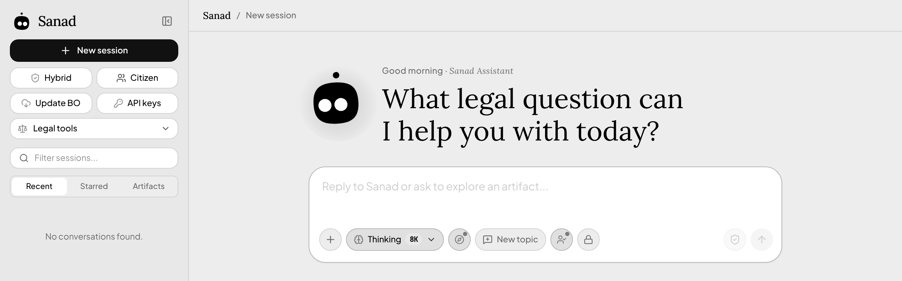
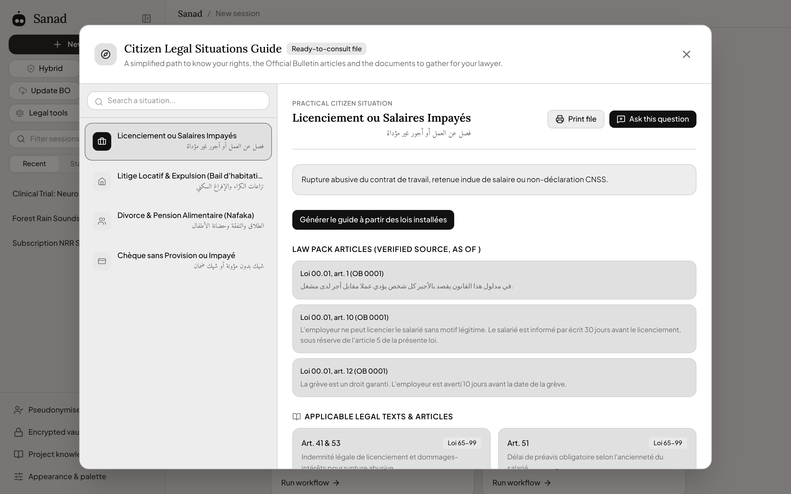
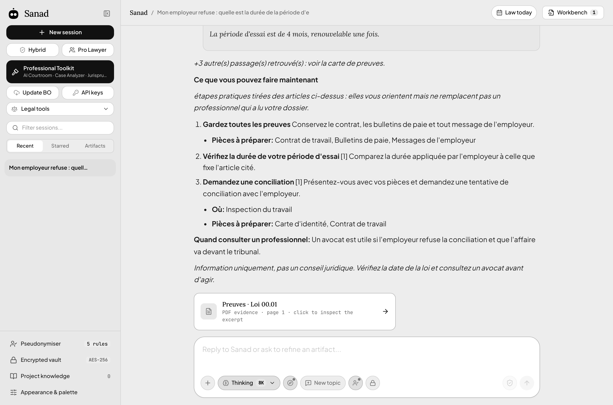
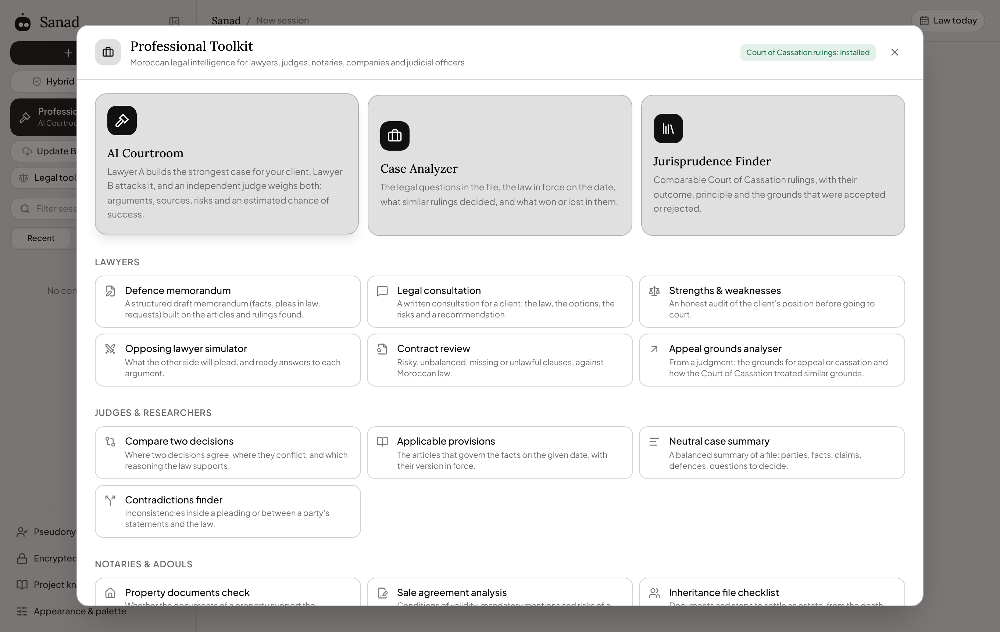
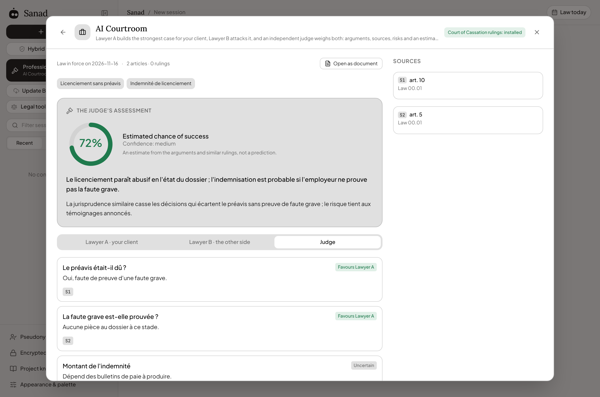
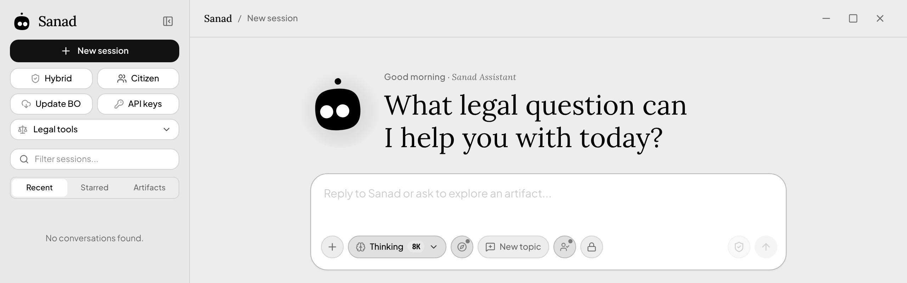

<div align="center">


# Sanad · سند

**A Moroccan law assistant that runs on your own computer and answers only from the official texts.**

Arabic · French · English · Darija

<a href="https://github.com/Ayyoubsghuri/Sanad/releases/latest"></a>
&nbsp;
<a href="https://github.com/Ayyoubsghuri/Sanad/releases/latest"></a>

<a href="https://github.com/Ayyoubsghuri/Sanad/releases/latest"></a>

**Nothing else to install: no Python, no database server, no account.** Run the installer and Sanad sets itself up
(the first start downloads the laws, about 2.5 GB, plus 4.5 GB of local models if you choose to install them).

[Install on Windows](#install-on-windows) · [Law pack on Hugging Face](https://huggingface.co/datasets/Xdnh00p/sanad-lawpack) · [Run from source](#run-from-source) · [How it works](#how-it-works)

<a href="docs/video/sanad-promo.mp4"></a>

<sub>▶ <a href="docs/video/sanad-promo.mp4">Watch the video with sound</a> (16 s)</sub>



</div>

Sanad searches Moroccan laws, codes and Official Bulletin issues, quotes the articles it relies on, and checks every
claim of the answer against those articles before showing it. Names, amounts and addresses are replaced by placeholders
on the device before anything is sent to a language model, and the app can also work fully offline.

> Sanad is a reading aid. It is not legal advice.

## What it does

| | |
|---|---|
| **Answers with sources** | Date-aware hybrid search (dense + keyword + reranker) over the law pack. Each answer cites articles, and unsupported claims are removed or the answer falls back to quoted passages. |
| **Privacy first** | The backend listens on `127.0.0.1` only. Personal data is pseudonymised locally; you see exactly what would be sent before it leaves. |
| **What to do next** | When you describe your own situation, the answer ends with practical steps in order: what to do, where, which papers to prepare, within which time limit, and when to see a professional. A step whose time limit or number is not in the articles it cites is removed. |
| **Court rulings** | About 26,000 Court of Cassation rulings (2008–2025), downloaded from inside the app. The closest ones appear under each answer, apart from the law, with their outcome and a link to the PDF. |
| **Professional toolkit** | In Pro Lawyer mode: AI Courtroom (two lawyers and a judge), Case Analyzer, Jurisprudence Finder and 24 tools for lawyers, judges, notaries, companies and judicial officers. |
| **Two operating modes** | Offline (no network calls, or a model running on your own computer with Ollama or LM Studio) and Hybrid (pseudonymised text to the model you choose). |
| **Legal tools** | Calculators (SMIG/SMAG, severance, deadlines, inheritance…), citizen situation guides, statute browser with the version in force on a given date, concordance tables, contract check. |
| **Signed law pack** | The laws and their embeddings ship as one signed file. A pack that is not signed by the publisher is refused. |
| **Stays current** | "Update BO" shows the installed and the published law pack and installs a newer one (checked against the publisher's signature), and finds new Official Bulletin issues and adds them to your local pack. |

## Screenshots

The screenshots below were taken with the small synthetic test pack (texts marked *FIXTURE*), not with the real law pack.

| Operating modes | Statute browser |
|---|---|
|  |  |

| Citizen situation guides | Pseudonymiser |
|---|---|
|  |  |

<div align="center">

</div>

| What to do next, at the end of an answer | Professional Toolkit |
|---|---|
|  |  |

<div align="center">

</div>

## Professional toolkit (Pro Lawyer mode)

Switch the sidebar's audience button to **Pro Lawyer** and open **Professional Toolkit**:

| Tool | What it does |
|---|---|
| **AI Courtroom** | Lawyer A builds the strongest case for your client, Lawyer B attacks it, and an independent judge weighs both side by side: the issues, which side each favours, risks, what to do, and an estimated chance of success (never 0 % or 100 %). |
| **Case Analyzer** | The legal issues of a file, the law in force on the chosen date, what similar Court of Cassation rulings decided, which arguments won and which lost there, evidence and next steps. |
| **Jurisprudence Finder** | Comparable Court of Cassation rulings with their outcome, principle, and the grounds that were accepted or rejected. |

Plus 24 tools for each profession: lawyers (defence memorandum, consultation, strengths and weaknesses, opposing lawyer
simulator, contract review, appeal grounds), judges and researchers (compare two decisions, applicable provisions,
neutral summary, contradictions), notaries (property documents, sale agreement, inheritance checklist, missing
documents, clauses vs legislation), company legal departments (employment contract, compliance, procurement, legal
risks, internal policy) and judicial officers (notices, deadlines, execution checklist, service record).

Every tool works the same way: the text is pseudonymised on the device and shown before it is sent; the law in force on
the date and similar rulings are found locally; the model may cite only those sources (a citation it invents is
removed and the point is marked "no source"); names are restored on the device; any result opens as a document to
export. Without a model (Offline mode) the tools list the articles and rulings found.

### Court rulings

The toolkit's home screen offers **Download court rulings**: about 26,000 Court of Cassation rulings (2008–2025, 800 MB),
each with its number, date, chamber, outcome, principle, and the grounds that were accepted or rejected. The file is
checked against its published SHA-256 before it is installed, a stopped download continues where it left off, and
**Update** appears when a newer set is published. Without the rulings the tools use the law alone and say so.

Once installed, the rulings are also used in the normal chat, in Citizen and Pro Lawyer mode: each answer lists the
closest rulings and how the most similar ones were decided. They are searched on the computer (nothing is sent) and
shown apart from the law, as an aid to interpretation.

## What to do next

A question about the law in general ("what is the notice period?") gets the articles and their explanation. When you
describe **your own situation** ("my employer dismissed me without notice after eight years…"), the answer also ends
with **What you can do now**:

- 3 to 6 steps in the order to take them, the most urgent first;
- for each step: where to go, the papers to prepare, the time limit, and the article it rests on;
- one line saying when a lawyer or another professional is needed.

The steps are written from the same articles as the answer and then checked in code: a step can only cite those
articles, and a step that gives a time limit with no article, or a number found neither in its articles nor in your
question, is removed. Fewer than two valid steps: the section is left out. On Android the section is written by the
model without this automatic check.

## Install on Windows

**[⬇ Download the latest version](https://github.com/Ayyoubsghuri/Sanad/releases/latest)** and run one of the two installers. They install the same thing; pick either.
**You do not need Python, a database server or administrator rights**: the installer brings everything Sanad needs.
The same page has the Android app (`Sanad-<version>.apk`); see [`mobile/android/README.md`](mobile/android/README.md) and the
release notes for what the phone version does not do yet.

| File | Type |
|---|---|
| `SanadSetup-<version>.exe` | Setup wizard (English, French, Arabic) |
| `Sanad-<version>.msi` | Windows Installer package, for example for `msiexec /i Sanad-<version>.msi` |

> [!IMPORTANT]
> **"Windows protected your PC"** — the installers are not code-signed yet, so Windows SmartScreen shows this blue
> warning the first time. The app is not broken. To continue:
>
> 1. Click **More info** (under the text of the warning).
> 2. Click **Run anyway**.
>
> To check that the file is the one published here, compare its SHA-256 with `SHA256SUMS.txt` on the release page:
> `certutil -hashfile SanadSetup-<version>.exe SHA256`

Both install for the current user only, without administrator rights, into `%LOCALAPPDATA%\Programs\Sanad`, and add a
**Sanad** shortcut with the Sanad logo to the Start menu and the desktop.

**The first start asks how Sanad should search by meaning**, before anything is downloaded:

| Your computer | Choice |
|---|---|
| Less than 16 GB of memory | **Cloudflare Workers AI** (the only option): no models are installed |
| 16 GB or more | **Install the models on this computer** or **Cloudflare Workers AI** |

- **Models on this computer:** everything runs locally, also in Offline mode, no account needed. About 7 GB to download.
- **Cloudflare Workers AI:** about 2.5 GB to download and light on memory, plus an optional small model (about 1 GB, ticked by default) that sorts the results by meaning on the computer. Sanad uses the same `bge-m3` model as the law
  pack's vectors, through your own free Cloudflare account: after the setup, open **API keys → Search by meaning** and
  enter the account ID and an API token with the Workers AI permission
  ([pricing and free allowance](https://developers.cloudflare.com/workers-ai/platform/pricing/)). Only the masked search
  text is sent, and each call appears in the outbound log. In Offline mode Sanad searches by keywords only.

To switch later, open **API keys → Search by meaning** in the app: it downloads the small model or the local models (16 GB or more) with a progress bar. **Sanad - repair setup** in the Start menu also asks again.

**Then it downloads everything else** (keep the internet connection and the window open):

1. A private Python 3.12 and the backend's packages, into `%LOCALAPPDATA%\Sanad`.
2. The signed law pack (`current.db`, about 2.3 GB) from
   [`Xdnh00p/sanad-lawpack`](https://huggingface.co/datasets/Xdnh00p/sanad-lawpack). Its SHA-256 and the publisher's
   signature are checked before it is installed into `%USERPROFILE%\.moroccan-legal-rag\lawpack`.
3. Only if you chose the local models: the models, into `%USERPROFILE%\.moroccan-legal-rag\models`: the reranker `BAAI/bge-reranker-v2-m3` and the
   embedding model the law pack was built with (`BAAI/bge-m3`).

A setup window shows the progress of that first start; no console window opens. If the download is interrupted,
start Sanad again: it continues where it stopped. **Sanad - repair setup** in the Start menu runs the setup again.

After the setup, the shortcut starts `Sanad.exe`, which opens Sanad in its own window: no browser, no console and no
Windows title bar. The window buttons (minimise, maximise, close) are in Sanad's own top bar, which also moves the
window; the bottom-right corner resizes it.



To get answers written by a language model, open **API keys** in the app and add a key (Anthropic or any
OpenAI-compatible endpoint). Without one, Sanad shows the cited articles only.

Requirements: Windows 10 or 11 (64-bit) with the WebView2 runtime (part of Windows 11 and of current Windows 10), about 12 GB of free disk space (5 GB with Cloudflare), 8 GB of RAM (16 GB for the local models). A GPU is
optional.

### Build the installers yourself

The installers are built on Linux by [`installer/build.sh`](installer/build.sh) (needs `node`, `python3`, `makensis`,
`wixl` and the MinGW cross-compiler), which is also what the [GitHub workflow](.github/workflows/installers.yml) runs:

```bash
sudo apt-get install -y nsis wixl gcc-mingw-w64-x86-64
```

```bash
installer/build.sh
```

The files are written to `installer/out/`. To publish a new version, change the number in
[`installer/VERSION`](installer/VERSION) on `main`: the workflow builds the two files and publishes them as the GitHub
Release `v<version>`, together with the Android app. Running the **Release** workflow by hand attaches the files to the run instead.

## Run from source

You need Python 3.11 or newer and Node.js 22.

**1. Backend**

```bash
cd backend
pip install -e ".[local-models]"
python tools/install_pack.py
python -m legalrag.fetch_models --pack-embedder
```

`install_pack.py` downloads the law pack named in [`backend/pack_release.json`](backend/pack_release.json) and prints
the publisher's key. Set it and start the backend:

```bash
export LEGALRAG_LAWPACK_PUBLIC_KEY_HEX=086dbbbf9cc34d77f65c376b480be3ab83ad25e12194efee5445a4241aded15c
legalrag
```

On Windows use `setx LEGALRAG_LAWPACK_PUBLIC_KEY_HEX <key>` and open a new terminal.

**2. Frontend**

```bash
cd frontend
npm ci --legacy-peer-deps
npm run dev
```

Open `http://localhost:3000`. The app pairs with the backend by itself; there is no token to copy.

To serve the built frontend from the backend instead (one process, as the installers do), run `npm run build` and
start the backend with `LEGALRAG_FRONTEND_DIR=../frontend/dist`, then open `http://127.0.0.1:8765`.

**Try it without the real pack**

```bash
cd backend
pip install -e ".[dev]"
legalrag-build fixture --out fixture.db
LEGALRAG_LAWPACK_PATH=fixture.db LEGALRAG_ALLOW_UNSIGNED_PACK=true legalrag
```

## The law pack

The repository holds the engine and the source texts. The searchable data is the **law pack**: a single SQLite file
with the texts, their versions over time and their embeddings, signed with Ed25519.

| | |
|---|---|
| Published at | [huggingface.co/datasets/Xdnh00p/sanad-lawpack](https://huggingface.co/datasets/Xdnh00p/sanad-lawpack) |
| Files | `current.db` and `current.db.sig` |
| Version | `2026.11.08.1455-retire` |
| Size | 2,270,830,592 bytes |
| SHA-256 | `6b8d461f7222dd749e4b52368abe55e5f2fe5fdfde1bcdd5f6ff155377fcf110` |
| Publisher key | `086dbbbf9cc34d77f65c376b480be3ab83ad25e12194efee5445a4241aded15c` |

Source texts in this repository (`backend/data/`): 8 codes (obligations and contracts, family, labour, penal, civil and
criminal procedure, commercial, tax), 160 laws, dahirs and decrees, and 48 local-authority gazettes.
[`backend/docs/LAW_IMPORT.md`](backend/docs/LAW_IMPORT.md) explains how to add a law, and
[`backend/README.md`](backend/README.md) how to build and publish a pack.

## How it works

```
question
   │  pseudonymise on the device, show the send preview
   ▼
understand ──► date-aware hybrid retrieval ──► rerank ──► generate (structured JSON)
                (dense + BM25, law pack)                        │
                                                                ▼
                    answer ◄── restore names locally ◄── verify each claim against the cited articles
                                                         (regenerate once, else verified claims only,
                                                          else quoted passages only)
                       │
                       ├─ similar Court of Cassation rulings (searched locally, shown apart from the law)
                       └─ what to do next (personal situations only; each step checked against its articles)
```

| Folder | Contents |
|---|---|
| [`backend/`](backend/) | FastAPI backend (`legalrag`): retrieval, verification, pseudonymisation, calculators, pack builder, tests |
| [`frontend/`](frontend/) | React + Vite interface |
| [`installer/`](installer/) | Windows installers (`.exe` with NSIS, `.msi` with WiX), the `Sanad.exe` launcher and the first-start setup |
| [`blueprint/`](blueprint/) | The design document in English, French and Arabic; the first pages are the November 2026 revision (rulings, Professional Toolkit, next steps, local model, amended rules and risks) |

## Limitations

- The calculators are labelled *unverified* unless they were checked against an official worked example.
- Pseudonymisation is based on patterns, dictionaries and an optional Arabic NER model. Review the send preview for
  unusual names.
- The court rulings were read from PDFs, partly by OCR: about one ruling in ten has an unclear outcome and some have no
  date. Open the PDF for anything you rely on. The chance of success in the AI Courtroom is an estimate, not a prediction.
- "What you can do now" guides you; it does not replace a professional who has read your file.
- The consolidated texts are built from public sources. Check the Official Bulletin for anything you rely on.
- More details in [`backend/README.md`](backend/README.md#honest-limitations).
